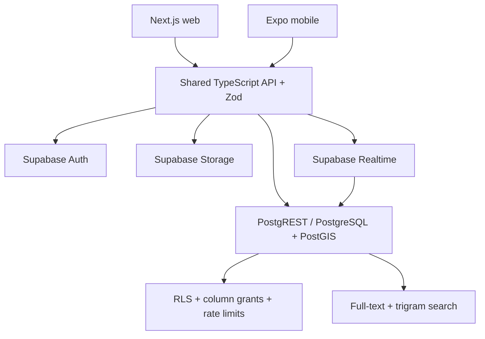
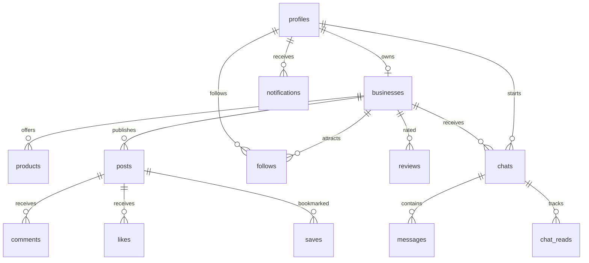

# Architecture and database schema

## Shared architecture

The clients use the same public Supabase key and the signed-in user's JWT. The API package validates input and provides typed methods. **PostgreSQL enforces authorization independently of client validation**, including against direct REST calls. No service-role credential is distributed with either app.

Next.js App Router provides the web shell and OAuth callback. Client-side TanStack Query handles session-specific cached reads, mutation invalidation, pagination, and error states. Session changes clear caches. The Expo app persists auth through AsyncStorage and starts/stops token refresh with app state. Use an encrypted session-storage adapter if your deployment threat model requires encrypted tokens at rest.

Postgres full-text search handles product/shop names, descriptions and categories. `pg_trgm` adds misspelling similarity and indexed name matching. PostGIS geography pins provide radius filtering and distances in kilometers. Search uses caller permissions (`security invoker`), so hidden/blocked content is excluded.

Realtime subscribes to inserts for the selected conversation. RLS filters delivery; switching/leaving the screen unsubscribes. The inbox polls unread counts; notifications poll on web and refresh after mutations. Chat images are private, with five-minute signed URLs; public business images use the Storage public CDN URL.

## Entity relationships

`profiles.id` is the one-to-one public profile for `auth.users.id`. Email and phone stay in Supabase Auth; public profile reads reveal only display name, account role, avatar and timestamps. Business contact information is deliberately public.

| Table         | Important columns / constraints                                                                                           | Access                                                       |
| ------------- | ------------------------------------------------------------------------------------------------------------------------- | ------------------------------------------------------------ |
| auth.users    | Supabase identity; email/phone/provider credentials                                                                       | Supabase Auth only                                           |
| profiles      | id FK, display_name, customer/owner role, avatar_url                                                                      | Public read; self edit                                       |
| admins        | user_id PK                                                                                                                | Trusted SQL only; is_admin RPC reveals caller membership     |
| businesses    | owner_id unique, name/category/description/contact/address/hours, lat/lng, generated geography + full-text vector, hidden | Visible public read; owner writes                            |
| products      | business_id, name/category/description, INR price numeric, image_url, availability, full-text vector                      | Visible public read; business owner writes                   |
| posts         | business_id, caption, image_url, post/offer/product kind, hidden                                                          | Visible public read; business owner writes                   |
| comments      | post_id, user_id, body, timestamp                                                                                         | Visible post read; self create/delete                        |
| likes         | composite PK user_id/post_id                                                                                              | Visible post read; self create/delete                        |
| saves         | composite PK user_id/post_id                                                                                              | Private to saver                                             |
| follows       | composite PK user_id/business_id                                                                                          | Public relations for visible businesses; self create/delete  |
| chats         | customer_id + business_id unique                                                                                          | Only the two participants; RPC creation                      |
| messages      | chat_id, sender_id, body/image_path, timestamp                                                                            | Participants; immutable, sender-authenticated insert         |
| chat_reads    | chat_id/user_id PK, read_at                                                                                               | Caller read; server timestamp via RPC                        |
| reviews       | business_id/user_id unique, 1–5 rating, body                                                                              | Visible public read; self write; no reviewing own business   |
| notifications | recipient, body, read_at, timestamp                                                                                       | Recipient only; server-created; read_at only editable        |
| blocks        | blocker_id/blocked_id PK, not self                                                                                        | Blocker manages; revokes chat both ways                      |
| reports       | reporter, target type/id, reason, open/resolved                                                                           | Reporter and admin read; reporter insert; admin RPC resolves |
| rate_limits   | user/action/minute PK, hit count                                                                                          | Private database implementation                              |

The migration is the authoritative schema. UUID foreign keys cascade related data on deletion. Owners cannot change ownership fields, timestamps or moderation flags because column grants restrict updates. Owner profile roles are intentionally self-selectable; admin membership is separate and cannot be self-selected.

## Performance choices and limits

- Twelve-item feeds/search pages; 50-message pages; client query cache, 30-second stale time. Mobile lists are virtualized FlatLists with pull-to-refresh.
- Deterministic feed order (`created_at`, `id`); offset pagination can shift when new posts arrive. Replace with compound keyset cursors for high-volume feeds.
- Mobile chat uses compound `(created_at,id)` cursors to avoid skipping tied timestamps. The web client retains its original timestamp-only cursor.
- GiST location, GIN full-text/trigram, and relationship/timestamp indexes.
- Web uploads resize to 1600px and WebP before upload; both clients restrict formats and size. Mobile selects compressed images. Public images load lazily on web.
- Feeds currently embed likes/comment IDs to display counts; replace with aggregate counters for large posts.
- Catalog, reviews, inbox and notifications have 100-row caps; add dedicated pagination as usage grows.
- Mobile screens, session handling, navigation and reusable UI are separated into `apps/mobile/src`. The web MVP screens remain in one module and can be split before expanding video/stories.

## Planned service adapters

Video: Mux or Cloudflare Stream direct-upload URLs minted by a trusted Supabase Edge Function; verify signed webhooks, track processing status, and expose playback only after moderation. Do not upload large videos to the image bucket.

Push: native FCM device registration, private token table, outbox worker/Edge Function with Firebase service credentials, retry/deduplication, preferences and logout token removal. Expo native FCM integration requires custom development builds. No push-success UI is presented in this MVP.

Map: optional Google Maps Embed browser key on web, external directions from both clients. A draggable picker and interactive mobile map are later phases. Location is requested only when the user selects Near me or Use current location; search coordinates are not stored as profile data.
